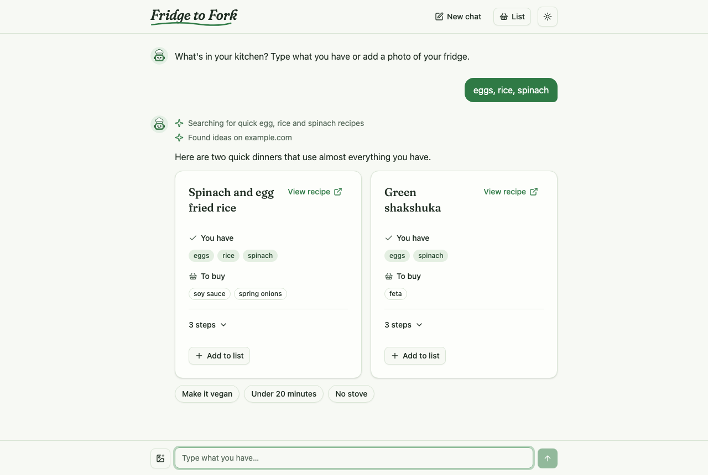
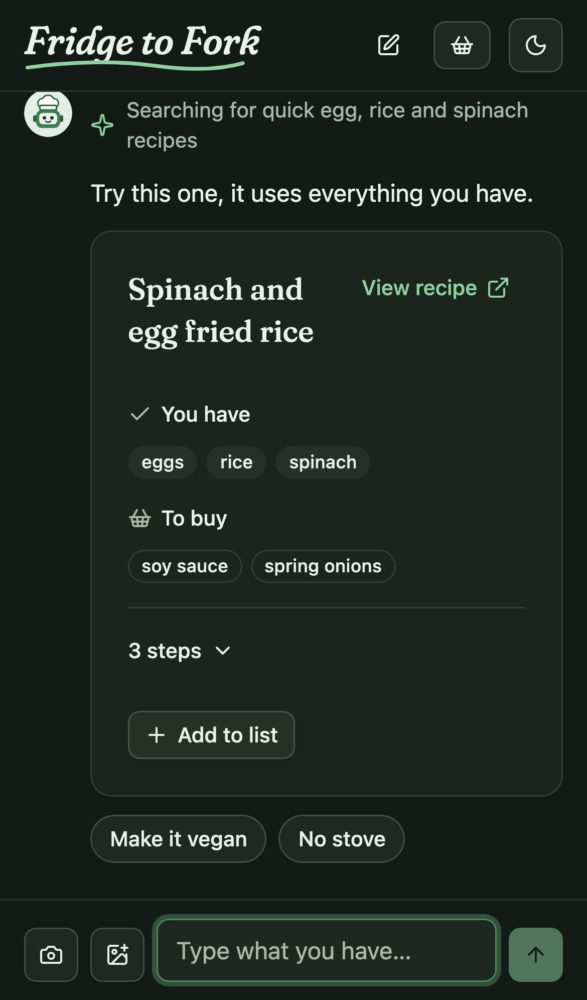
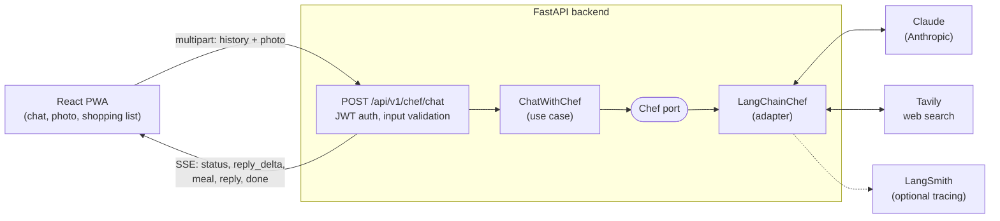

# Fridge to Fork

Tell it what's in your fridge, as text or a photo, and an AI chef suggests meals you can cook now. For each meal it lists what you already have, what you still need to buy and short steps. It also links the recipe it based the meal on.

<p align="center">
  
</p>

<p align="center">
  
</p>

## What it does

- **Chat with a chef agent.** Ask for ideas, then refine them: "make it vegan", "under 20 minutes", "no oven". It treats allergies, diets and equipment limits you mention as hard rules for the rest of the chat.
- **Photo input.** Snap or upload a photo of your fridge. A vision-capable Claude model reads the ingredients.
- **Live web research.** The agent searches the web for real recipes (Tavily) and shows its progress ("Searching for…", "Found ideas on…") as it goes.
- **Streaming UI.** The reply text and meal cards appear as they are generated, over Server-Sent Events.
- **Shopping list.** Add meals to a list that merges their missing ingredients and copies them in one tap.
- **Installable PWA.** It works on a phone home screen, with camera capture, dark mode and keyboard and screen-reader support.

## How it works



The chef lives in `backend/app/chef/` and follows a **ports-and-adapters (hexagonal)** layout:

| Layer | Folder | Responsibility |
| --- | --- | --- |
| Domain | `domain/` | Meal, chat message and image rules (size, type, history shape), the events the chef emits, and the `Chef` port. No framework imports. |
| Application | `application/` | The `ChatWithChef` use case. |
| Infrastructure | `infrastructure/` | The LangChain agent (Claude + Tavily tool), structured output parsing, streaming partial JSON into reply deltas and meals, and prompt caching. |
| API | `api/` | FastAPI route, request validation and mapping domain events to SSE. |

The server is **stateless**: the browser keeps the conversation and sends the last 20 messages with each turn. Photos are only sent once and are never stored.

## Tech stack

**Backend:** Python 3.14, FastAPI, SQLModel and PostgreSQL, Alembic, LangChain (`create_agent`, structured output), Anthropic Claude, Tavily, LangSmith, pytest, mypy, ty and Ruff.

**Frontend:** React, TypeScript, Vite, TanStack Router and Query, Tailwind CSS, shadcn/ui, Zod, Playwright and Biome.

**Ops:** Docker Compose, Traefik, GitHub Actions CI and a Dokploy deployment file.

The user accounts, auth and admin screens come from the [Full Stack FastAPI Template](https://github.com/fastapi/full-stack-fastapi-template). The chef feature (backend module, chat UI, tests and PWA) is new work built on top of it.

## Run it locally

You need [Docker](https://docs.docker.com/get-docker/) and two API keys:

- an **Anthropic** key from [console.anthropic.com](https://console.anthropic.com)
- a **Tavily** key from [app.tavily.com](https://app.tavily.com) (there is a free tier)

### Option A: Docker (quickest)

```bash
git clone https://github.com/hamdi-ben-yaflah/fridge-to-fork.git
cd fridge-to-fork

cp backend/.env.example backend/.env   # then paste your two keys into backend/.env

docker compose build backend
docker compose run --rm backend bash scripts/prestart.sh   # migrations + first admin user
docker compose up -d --wait backend
```

Open <http://localhost:8000>. Log in as `admin@example.com` with password `changethis`, then click **Open the kitchen**.

To stop it, run `docker compose down`. Add `-v` to delete the database too.

> Port 5432 or 8000 already in use? Stop the other service, or change the ports in `compose.override.yml`.

### Option B: Development mode (hot reload)

Also needs [uv](https://docs.astral.sh/uv/) and [Bun](https://bun.sh).

```bash
cp backend/.env.example backend/.env   # add your keys
docker compose up -d db mailpit        # Postgres + a local mail catcher

# terminal 1: API on http://localhost:8000 (docs at /docs)
cd backend
uv sync
uv run bash scripts/prestart.sh
uv run fastapi dev

# terminal 2: UI on http://localhost:5173
bun install
bun run dev
```

### Configuration

| File | Committed | Holds |
| --- | --- | --- |
| `.env` | yes | Local, non-secret defaults: database password, first admin user, `SECRET_KEY`. All are `changethis`, and the backend refuses to start with these values unless `FASTAPI_ENV=development`. |
| `backend/.env` | **no** (gitignored) | Your API keys: `ANTHROPIC_API_KEY`, `TAVILY_API_KEY`, plus optional `LANGSMITH_API_KEY` for tracing. See `backend/.env.example`. |

## Tests

```bash
# Backend: needs `docker compose up -d db`
cd backend && uv run bash scripts/tests-start.sh

# End-to-end: needs Postgres, Mailpit, the API and `bun run dev` running (see Option B)
bun run test
```

The chef's tests use a fake chef and stubbed SSE responses, so **they need no API keys and make no network calls**. The backend tests cover each layer separately: domain rules, the use case, the LangChain adapter's streaming and parsing, and the HTTP contract. The Playwright suite covers the chat end to end, including photos, errors, retries, stopping a reply, the shopping list and the phone layout.

## Deploying

- `compose.yml` + `compose.deploy.yml`: self-hosted with Traefik and automatic HTTPS.
- `compose.dokploy.yml`: for [Dokploy](https://dokploy.com), which provides its own proxy. Set `DOMAIN`, `SECRET_KEY`, `POSTGRES_PASSWORD`, `FIRST_SUPERUSER*`, `ANTHROPIC_API_KEY` and `TAVILY_API_KEY` in its UI.

Before exposing it publicly, read the limits below. Each chef turn costs real API money.

## Security notes

- No credentials are committed. Real keys belong only in `backend/.env` (gitignored, excluded from the Docker build context) or in your host's secret settings.
- The chef endpoint requires a logged-in user, so anonymous visitors can't spend your API credits.
- Input is validated at the boundary: the conversation schema, history length, text length, image type (JPEG, PNG, WebP, GIF) and image size (7 MB max).
- Each agent turn has a time limit and a cap on tool-call steps.
- Passwords are hashed and auth uses JWTs. Default secrets are rejected outside development.

## Skills this project demonstrates

- **LLM application engineering:** a tool-using agent with LangChain, structured output validated by Pydantic, multimodal (image) input, prompt caching to cut cost and latency, and LangSmith tracing.
- **Streaming UX:** turning partial structured output into incremental SSE events, so the reply text and each meal card render as soon as they're ready.
- **Clean architecture:** the domain and use case don't depend on LangChain or FastAPI, so the model provider could be swapped by writing a new adapter.
- **Test-driven development:** the chef was built test-first, with fast unit tests and a broad Playwright suite. No test touches a real LLM.
- **Full-stack product work:** a typed React client, accessible chat UI, PWA, camera capture, dark mode and mobile layout.
- **Delivery:** Dockerized, CI on GitHub Actions and a reproducible self-hosted deploy.

## Strengths and limits

**Strengths**

- Fast to feel useful: the first ideas appear within seconds, and progress is visible while the agent searches.
- The server is stateless and stores no chat or photos. That makes it simple to scale and keeps privacy risk low.
- The LLM is behind a port, so tests are deterministic and the provider can be swapped.
- Meals are grounded in real recipes found on the web, with links back to the source.

**Limits**

- **Cost exposure:** sign-up is open and there is no per-user rate limit or quota yet.
- **Chats aren't saved.** They disappear when you start a new chat or refresh the page.
- **The client sends the history.** A user could edit their own history; it only affects their own session.
- **No safety guarantee for food.** Allergy rules depend on the model following instructions, so this is not suitable as medical or dietary advice.
- **English only.** Answer quality isn't measured with automated evals.

## Ideas for the future

- Per-user rate limits and a monthly spend cap. Invite-only sign-up by default.
- An evaluation suite (for example LangSmith datasets) to score meal relevance, missing-ingredient accuracy and allergy compliance.
- Saved chats and a "pantry" that remembers staples you always have.
- Nutrition and cost estimates per meal. Multi-language replies.
- Support for more model providers through new `Chef` adapters (OpenAI, local models).

## License

MIT. See [LICENSE](LICENSE). Based on the MIT-licensed [Full Stack FastAPI Template](https://github.com/fastapi/full-stack-fastapi-template) by Sebastián Ramírez.
